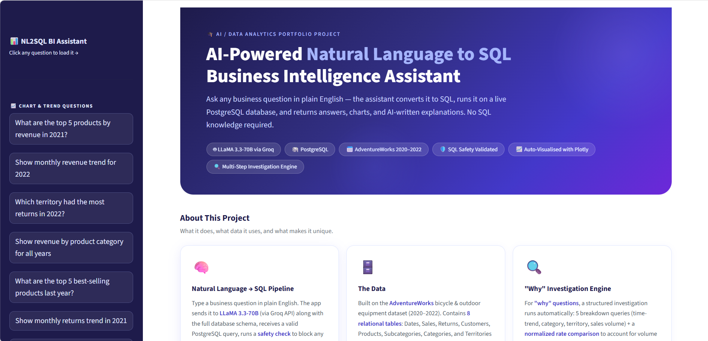
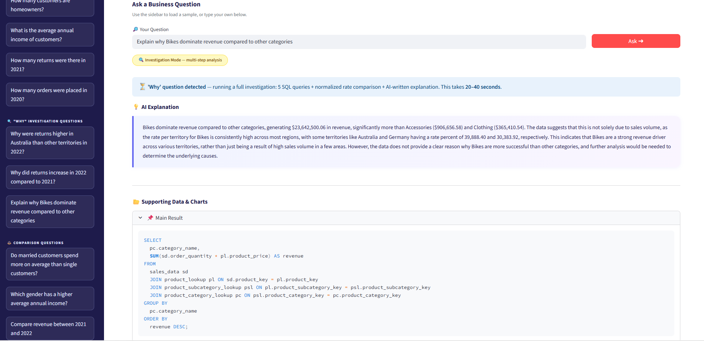
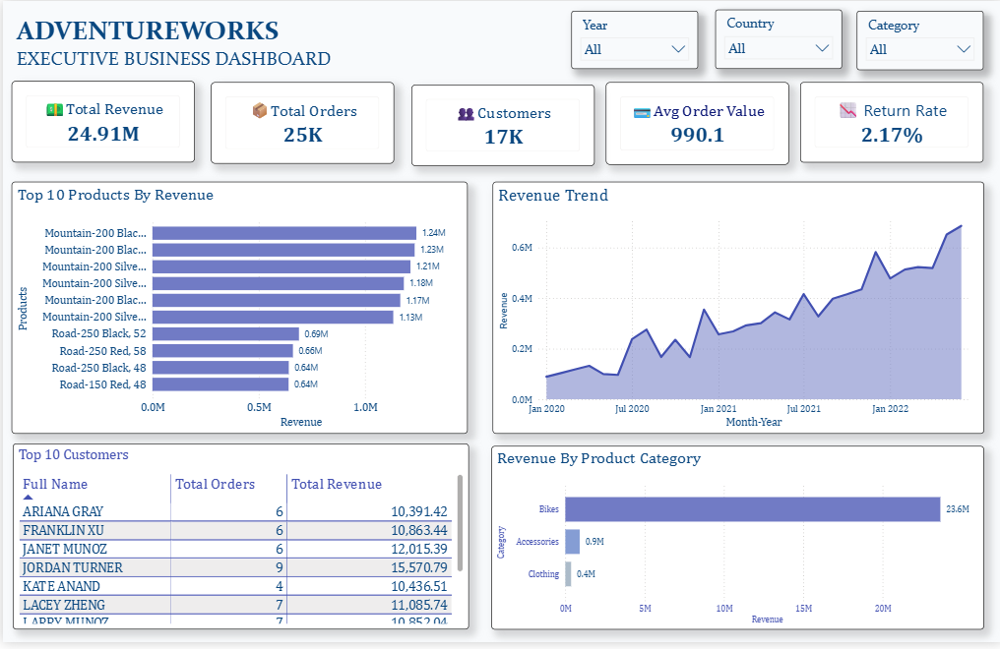
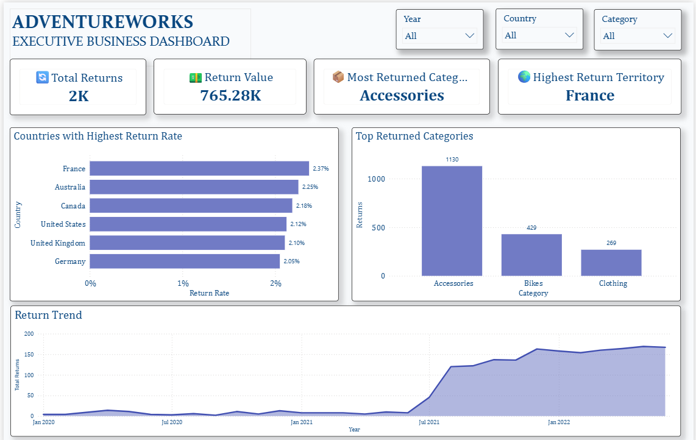
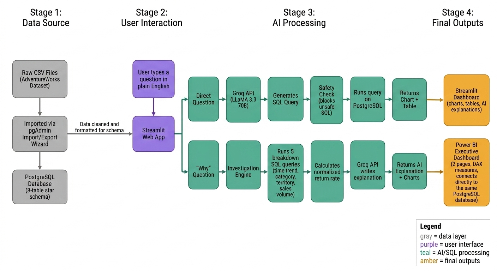

# 📊 AI-Powered Natural Language to SQL Business Intelligence Assistant

An end-to-end AI-powered Business Intelligence system that lets users query a PostgreSQL database using plain English.

The assistant converts natural language questions into validated SQL, executes them against PostgreSQL, automatically visualizes the results, and — for **"why" questions** — runs a structured multi-step investigation to produce a written, data-grounded explanation.

🔗 **[Live Demo](https://eo2y63umwncbb93egwmjvu.streamlit.app/)**

---

## 🖼️ Screenshots

### AI Assistant — Landing Page



### AI Assistant — "Why" Investigation



### Power BI — Executive Overview



### Power BI — Returns Analysis



---

## 🏗️ System Architecture



The system follows an end-to-end pipeline:

**Natural Language → LLM → SQL Generation → SQL Validation → PostgreSQL → Data Processing → Visualization → Business Insights**

For analytical **"why" questions**, the system additionally triggers a structured investigation workflow that performs multiple data breakdowns before generating the final explanation.

---

## 🌟 Key Features

### 🔤 Natural Language → SQL

Ask business questions in plain English without writing SQL manually. The LLM generates SQL based on the database schema and executes it against PostgreSQL.

### 🔎 "Why" Investigation Engine

Causal or diagnostic questions trigger an automated **5-query investigation** covering:

* Time trends
* Product/category breakdown
* Territory analysis
* Sales volume
* Normalized rate comparison

The results are synthesized into a plain-English, data-grounded explanation.

### 🛡️ SQL Safety Guardrail

A code-level safety layer independently validates generated SQL before execution.

Only `SELECT` statements are allowed, preventing potentially destructive operations such as:

* `INSERT`
* `UPDATE`
* `DELETE`
* `DROP`
* `ALTER`
* `TRUNCATE`

### 📊 Automatic Visualization

Query results are automatically visualized based on the structure of the returned data.

The visualization engine supports:

* Line charts for time-series data
* Bar charts for categorical comparisons
* Automatic numeric-type handling
* Preference for normalized rate metrics when both raw counts and rates are available

### 📈 Power BI Executive Dashboard

A complementary Power BI reporting layer provides always-on business reporting with DAX measures for:

* Revenue
* Returns
* Territory performance
* Product performance
* Customer analysis

### 🧪 Automated Testing

The project includes **18 automated unit tests** covering:

* SQL safety validation
* Rate-normalization logic
* Chart-selection logic

Tests run automatically on every GitHub push using **GitHub Actions**.

---

## 🧠 What Makes This Project Interesting?

Most Natural Language-to-SQL projects stop at:

> **Ask a question → Generate SQL → Return results**

This project goes further.

A **"why" question** cannot always be answered reliably using a single query. A single query can retrieve data, but it does not necessarily explain the underlying reason for a business outcome.

To address this, the system uses a structured investigation engine that performs multiple analytical breakdowns and compares **normalized rates instead of relying only on raw counts**.

### 📌 Example: Return-Rate Investigation

During development, an early version of the system used raw return counts.

Australia had **208 returns**, the highest among the territories, which initially suggested that Australia had an unusually high return problem.

However, after introducing volume normalization, the system calculated the actual return rate:

* 🇦🇺 Australia: **2.19%**
* 🇫🇷 France: **2.67%**
* 🇺🇸 Southeast: **2.86%**

The analysis therefore revised the conclusion.

Australia's high raw return count was primarily explained by its higher sales volume rather than an unusually high return rate.

This demonstrates an important BI principle:

> **Raw counts can be misleading when business units have different volumes.**

The investigation engine identifies this distinction and incorporates it into the final AI-generated explanation.

---

## 🛠️ Tech Stack

| Category              | Technology               |
| --------------------- | ------------------------ |
| Programming Language  | Python 3.10              |
| Database              | PostgreSQL 17            |
| Database Access       | SQLAlchemy               |
| Data Processing       | pandas                   |
| LLM                   | Groq API — LLaMA 3.3 70B |
| Visualization         | Plotly                   |
| Frontend              | Streamlit                |
| Business Intelligence | Power BI                 |
| Testing               | pytest                   |
| CI/CD                 | GitHub Actions           |
| Evaluation            | pandas, CSV              |

---

## 🗄️ Dataset

The project uses a subset of the **AdventureWorks bicycle and outdoor equipment dataset**, covering the period **2020–2022**.

The database follows a relational/star-schema structure containing **8 connected tables**.

### Database Tables

| Table                        | Description                     |
| ---------------------------- | ------------------------------- |
| `sales_data`                 | Main sales fact table           |
| `returns_data`               | Product return transactions     |
| `customer_lookup`            | Customer information            |
| `product_lookup`             | Product information             |
| `product_subcategory_lookup` | Product subcategory information |
| `product_category_lookup`    | Product category information    |
| `territory_lookup`           | Sales territory information     |
| `calendar_lookup`            | Date/calendar dimension         |

---

## 🚀 Setup Instructions

### 1. Prerequisites

Make sure you have:

* Python 3.9+
* PostgreSQL installed and running
* A free Groq API key

---

### 2. Clone the Repository

```bash
git clone https://github.com/PoojaDhamale/AI-Business-Analyst.git
cd AI-Business-Analyst
```

---

### 3. Create a Virtual Environment

```bash
python -m venv venv
```

#### Windows

```bash
venv\Scripts\activate
```

#### macOS / Linux

```bash
source venv/bin/activate
```

---

### 4. Install Dependencies

```bash
pip install -r requirements.txt
```

---

### 5. Configure Environment Variables

Create a `.env` file from the provided example:

```bash
cp .env.example .env
```

For Windows, you can also manually copy `.env.example` to `.env`.

Then add your credentials:

```env
DATABASE_URL=your_postgresql_connection_string
GROQ_API_KEY=your_groq_api_key
```

> **Never commit your `.env` file or API keys to GitHub.**

---

### 6. Set Up the Database

Create a PostgreSQL database and execute:

```text
database/schema.sql
```

You can run the schema using **pgAdmin → Query Tool**.

Then import each AdventureWorks CSV file into its corresponding PostgreSQL table using the pgAdmin **Import/Export Data** option.

Make sure:

* `Header` is enabled
* CSV columns match the database schema
* Primary and foreign-key relationships are preserved

---

### 7. Run the Application

```bash
streamlit run src/nl2sql/app.py
```

The application will be available at:

```text
http://localhost:8501
```

---

### 8. Run Tests

Install pytest if required:

```bash
pip install pytest
```

Run the complete test suite:

```bash
pytest tests/ -v
```

Expected result:

```text
18 tests passed
```

The same tests are automatically executed through GitHub Actions on every push.

---

## 🧪 Evaluation

The NL-to-SQL pipeline was evaluated using **14 test questions** covering:

* Simple aggregations
* Multi-table joins
* Joins involving up to 4 tables
* Comparisons
* Relative date phrasing
* Out-of-schema questions
* Ambiguous questions
* Edge cases

### Result

**Accuracy: 92.9% (13/14)**

The single failure involved a question referencing a `payment_method` field that does not exist in the database schema.

This was identified as a **data-availability/schema limitation rather than a SQL-generation failure**.

The same issue occurred with the manually written expected SQL because the requested field is not present in the dataset.

Complete evaluation scripts and results are available in:

```text
evaluation/
```

---

## 🧾 Hand-Written SQL Analysis

The project also includes manually written analytical SQL queries in:

```text
database/SQL_Analysis.sql
```

These queries cover:

* Revenue analysis
* Revenue breakdowns
* Top products
* Top customers
* Customer Lifetime Value
* Return-rate analysis
* Month-over-month growth
* Product rankings within categories

Window functions such as:

```sql
LAG()
```

and

```sql
RANK()
```

are also used for advanced analytical queries.

All evaluation ground-truth queries were independently written and verified in pgAdmin before being compared with the AI-generated SQL.

---

## 🐛 Notable Engineering Challenges

| Challenge                                              | Solution                                                             |
| ------------------------------------------------------ | -------------------------------------------------------------------- |
| PostgreSQL `NUMERIC` columns broke chart rendering     | Added defensive `pd.to_numeric()` conversion after query execution   |
| LLM occasionally generated multiple SQL statements     | Added an explicit single-statement rule and defensive SQL truncation |
| `EXTRACT(MONTH FROM date)` merged multiple years       | Added `DATE_TRUNC` rules for proper multi-year time-series analysis  |
| Integer month values were misinterpreted as timestamps | Added defensive date-detection logic in the visualization layer      |
| Free-tier LLM provider access was unreliable           | Migrated from Google Gemini to Groq using LLaMA 3.3 70B              |
| Raw return counts produced misleading conclusions      | Added normalized return-rate analysis based on sales volume          |

---

## 📂 Project Structure

```text
AI-Business-Analyst/
│
├── .github/
│   └── workflows/
│       └── tests.yml
│
├── data/
│   ├── AdventureWorks_sales.csv
│   ├── AdventureWorks_returns.csv
│   ├── AdventureWorks_customer.csv
│   ├── AdventureWorks_product.csv
│   ├── AdventureWorks_subcategory.csv
│   ├── AdventureWorks_category.csv
│   ├── AdventureWorks_territory.csv
│   └── AdventureWorks_calendar.csv
│
├── database/
│   ├── schema.sql
│   └── SQL_Analysis.sql
│
├── docs/
│   └── architecture.png
│
├── evaluation/
│   └── Evaluation.csv
│
├── powerbi/
│   ├── adventureworksdashboard.pbix
│   └── Dashboard_Screenshots/
│       ├── Page1.png
│       └── Page2.png
│
├── src/
│   └── nl2sql/
│       ├── app.py
│       ├── nl2sql.py
│       ├── analysis.py
│       ├── visualize.py
│       ├── schema_context.py
│       └── evaluate.py
│
├── tests/
│   ├── conftest.py
│   ├── test_nl2sql.py
│   ├── test_analysis.py
│   └── test_visualize.py
│
├── UI/
│   ├── Landing_page.png
│   └── Why_question.png
│
├── .env.example
├── .gitignore
├── README.md
└── requirements.txt
```

---

## 🔄 How It Works

```text
User asks a business question
            ↓
     Natural Language
            ↓
       LLM / Groq
            ↓
      SQL Generation
            ↓
     SQL Safety Check
            ↓
    SELECT-only Validation
            ↓
       PostgreSQL
            ↓
       Query Results
            ↓
     ┌───────────────┐
     │ Visualization │
     │   Generation  │
     └───────────────┘
            ↓
       Business Data
```

For **"why" questions**:

```text
User asks "Why did returns increase?"
                ↓
       Investigation Engine
                ↓
      ┌─────────┼─────────┐
      ↓         ↓         ↓
   Time      Category   Territory
   Trend     Analysis   Analysis
      ↓         ↓         ↓
   Volume   Normalized Rate
      └─────────┬─────────┘
                ↓
        LLM Synthesis
                ↓
     Data-Grounded Explanation
```

---

## 🔐 Security

The application includes a code-level SQL safety guardrail that validates generated SQL before database execution.

The system only permits read-only `SELECT` queries.

Database credentials and API keys are stored using environment variables and should never be committed to the repository.

---

## 📌 Future Improvements

Potential extensions include:

* Conversational memory for follow-up questions
* More advanced anomaly detection
* Automated KPI monitoring
* Natural-language dashboard generation
* Query result caching
* Role-based database access
* More comprehensive SQL evaluation benchmarks
* Support for additional database engines

---

## 👩‍💻 Author

**Pooja Dhamale**

B.E. — Artificial Intelligence & Data Science

[GitHub](https://github.com/PoojaDhamale)

---

## ⭐ If You Find This Project Useful

If you found this project interesting, consider giving the repository a ⭐ on GitHub.
